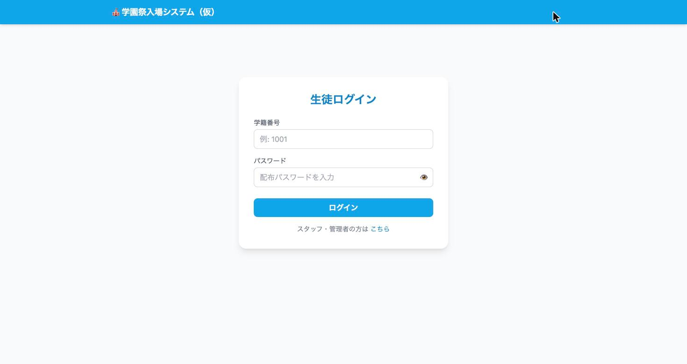
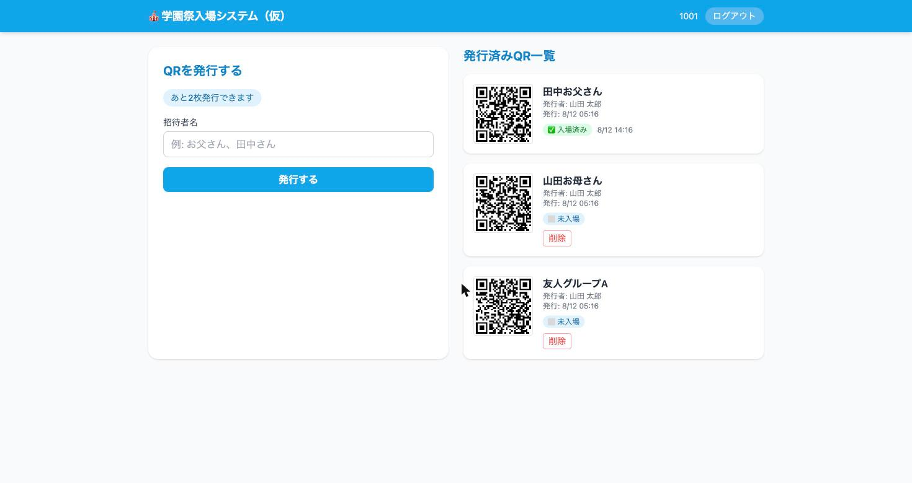
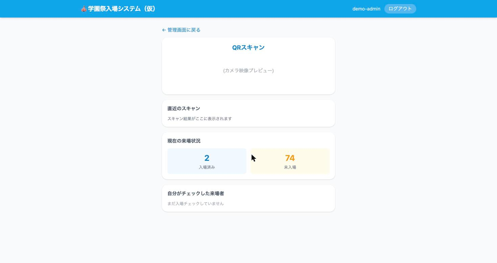
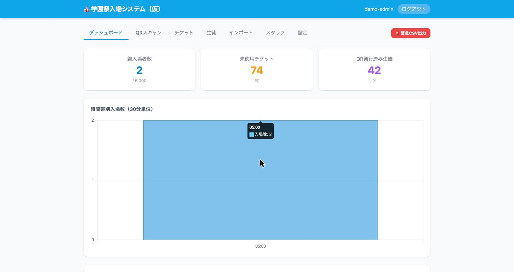

# MONpass (Cloudflare Workers版)

学園祭入場管理システム。Cloudflare Workers + Hono + D1 上で完結して稼働する。生徒が入場QRチケットを自分で発行し、会場入口でスタッフ・管理者がQRをスキャンして入場処理を行う。想定規模は生徒約1000名・チケット最大6000枚程度。

単一のCloudflare Workersプロジェクトが API と静的アセットの両方を同一オリジンで配信する(Cloudflare Pagesは不使用、CORS設定は不要)。元々はFastAPI + SQLiteの別実装(非公開リポジトリ、以下「旧Python版」)からの移行として作られた。

## 目次

- [スクリーンショット](#スクリーンショット)
- [クイックスタート(セルフホスト)](#クイックスタートセルフホスト)
- [ロール](#ロール)
- [運用・更新](#運用更新)

---

## スクリーンショット

| 生徒ログイン | QR発行・一覧(生徒) |
|---|---|
|  |  |

| QRスキャン(スタッフ) | ダッシュボード(管理者) |
|---|---|
|  |  |

---

## クイックスタート(セルフホスト)

このリポジトリは特定のドメイン(`hide23.link`)に依存しないよう設計してあり、別のCloudflareアカウント・別のドメインで自分の学校/団体用に立てることができる。

### 前提

- Node.js 20以降、npm
- bash、git、openssl(`scripts/setup.sh`が内部で使用。macOS/Linuxには標準で入っている)
- Cloudflareアカウント(無料枠で足りる規模)
- (任意)独自ドメインをCloudflareのゾーンとして追加済みであること — 独自ドメインなしでも `*.workers.dev` で動作する

### 動作環境

`scripts/setup.sh`はbash・対話的なターミナル(TTY)を前提にしている。

- **macOS / Linux**: そのまま動作する
- **WSL(Windows Subsystem for Linux、WSL2推奨)**: WSL内(Windows側ではなく)にNode.js/npm/git/opensslを入れていれば動作する。`wrangler login`のブラウザ認証は、自動で開かない場合はターミナルに表示されるURLをコピーしてWindows側のブラウザで開けばよい。`/mnt/c/...`のようなWindowsドライブ上ではなく、WSLのLinuxファイルシステム側(`~/`配下等)にcloneすると速い
- **Windows(WSLなし、cmd/PowerShellのみ)**: 未対応。bash互換シェルが必要
- **CI/CD等の非対話環境**: 未対応(対話プロンプトを前提にしているため)

### Cloudflare側の事前準備

`scripts/setup.sh` を実行する前に、Cloudflare側で以下を済ませておく。

1. **Cloudflareアカウントを作成する**
   [https://dash.cloudflare.com/sign-up](https://dash.cloudflare.com/sign-up) から登録し、届いた確認メールのリンクを開いてメールアドレスを認証する。プランは無料(Free)のままでよい。Workers・D1とも無料枠の範囲で動く。
2. **公開URLの種類を決める**
   - **独自ドメインなし(`*.workers.dev`)の場合**: ダッシュボード左メニューの「Workers & Pages」(表記はダッシュボードの更新で変わることがある)を一度開き、アカウント固有の `workers.dev` サブドメイン(例: `myschool.workers.dev`)を登録しておく。未登録のまま初回デプロイすると、wrangler が登録するよう対話で求めてくる。アプリのURLは `https://<Worker名>.<サブドメイン>.workers.dev` になる。
   - **独自ドメインを使う場合**: ダッシュボードの「ドメインを追加」(Add a domain)でドメインをCloudflareに追加する。続けて、ドメインを買ったレジストラ側でネームサーバーをCloudflareが指定するものに変更する。ドメインのステータスが「アクティブ」になるまで待つ(数分〜最大24時間程度)。アプリに使うサブドメイン(例: `monpass.example.com`)の **DNSレコードは自分で作らない**。デプロイ時に Workers の Custom Domains 機能が自動で作成する。同じ名前のレコードがすでにあるとデプロイが失敗するので、ある場合は先に削除しておく。
3. **wrangler(Cloudflare公式CLI)でログインできることを確認する**
   wrangler は `npm install` でプロジェクトに入るので、別途インストールは不要。`setup.sh` は未ログインなら自動で `wrangler login` を起動する。ブラウザが開いたらCloudflareにログインし、表示されたアクセス許可画面で「Allow」を押す。事前に確認したい場合は次を実行する。

   ```bash
   npx wrangler login
   npx wrangler whoami   # ログイン中のアカウント名・アカウントIDが表示されればOK
   ```

   複数のCloudflareアカウントに所属している場合は、`whoami` の結果に目的のアカウントが含まれていることを確認する。wrangler がどのアカウントを使うか尋ねてきたら、そのアカウントを選ぶ。

### 初回構築(経験者向け・1回だけ)

```bash
git clone <このリポジトリ> monpassc-myschool
cd monpassc-myschool
npm install
bash scripts/setup.sh
```

`scripts/setup.sh` が対話形式で以下を行う:

1. `wrangler login`(未ログインの場合)
2. Worker名・カスタムドメイン有無・D1データベース名・サイトタイトルなどをプロンプトで確認
3. `wrangler d1 create` でD1データベースを新規作成し、`wrangler.jsonc.template` から実際の `wrangler.jsonc` を生成
4. D1マイグレーション適用(ローカル・リモート両方)
5. `JWT_SECRET` をランダム生成して `wrangler secret put`
6. 最初の管理者アカウントをID/パスワード入力させて直接D1にシード(`scripts/create-admin.mjs` を内部で使用。このアプリには「初期管理者を自動作成する」仕組みがないため、この一度だけの直接シードが唯一の起点になる)
7. `wrangler deploy` で本番デプロイ

サイトのタイトル(ブラウザタブ・ナビバー・PWAの名前)は入力を空欄にすると既定値「学園祭入場システム（仮）」のままになる。後から変更したい場合は `node scripts/set-app-title.mjs "新しいタイトル"` を実行すればよい。

### 構築結果の確認(Cloudflareダッシュボード)

`setup.sh` が終わったら、Cloudflareに次のものが登録されているかダッシュボードで確認する。

| 確認する場所 | 登録されているべきもの |
|---|---|
| 「Workers & Pages」の一覧 | 入力したWorker名(既定 `monpassc`)のWorker |
| 上記Worker →「設定(Settings)」→「ドメインとルート(Domains & Routes)」 | 独自ドメイン(Custom Domain)、または `*.workers.dev` のURL |
| 上記Worker →「設定」→「変数とシークレット(Variables and Secrets)」 | `JWT_SECRET`(種類: シークレット、値は表示されない)と `DOMAIN`・`MAX_TICKETS`・`ISSUE_START_DATE`・`ISSUE_END_DATE` |
| 「ストレージとデータベース(Storage & Databases)」→「D1 SQL Database」 | 入力したDB名(既定 `monpass-db`)のデータベース。中に `students`・`tickets`・`staff`・`settings`・`login_failures` テーブルと、マイグレーション管理用の `d1_migrations` テーブルがある |

最初の管理者が登録されたかは、D1の「コンソール(Console)」タブで `SELECT id, role FROM staff;` を実行するか、次のコマンドで確認できる。

```bash
npx wrangler d1 execute monpass-db --remote --command "SELECT id, role FROM staff;"
```

その後、アプリのURLを開き、生徒ログイン画面の「スタッフ・管理者の方は こちら」から管理者IDでログインできれば構築は完了。

### setup.shを使わずに手動で構築する場合

`setup.sh` が途中で失敗した場合や、各ステップを自分で確認しながら進めたい場合の手順。以下では例として Worker名 `monpassc`、DB名 `monpass-db` を使う。

1. **依存関係のインストールとログイン**

   ```bash
   npm install
   npx wrangler login
   ```

2. **D1データベースを作成する**

   ```bash
   npx wrangler d1 create monpass-db
   ```

   出力に表示される `database_id`(`xxxxxxxx-xxxx-xxxx-xxxx-xxxxxxxxxxxx` の形式)を控える。あとで確認したいときは `npx wrangler d1 list` で一覧を表示できる。ダッシュボードの「D1 SQL Database」→「作成」から作ってもよい。

3. **`wrangler.jsonc` を作成する**

   ```bash
   cp wrangler.jsonc.template wrangler.jsonc
   ```

   エディタで開き、プレースホルダーを置き換える。

   | プレースホルダー | 置き換える値 |
   |---|---|
   | `__WORKER_NAME__` | Worker名(例: `monpassc`)。英小文字・数字・ハイフンのみ |
   | `__DB_NAME__` | D1のDB名(例: `monpass-db`) |
   | `__DB_ID__` | 手順2で控えた `database_id` |
   | `__MAX_TICKETS__` | 生徒1人あたりのチケット上限(例: `5`) |
   | `__DOMAIN_VALUE__` | 独自ドメインならそのホスト名(例: `monpass.example.com`)。`workers.dev` なら、いったん仮の値のまま進めて手順7で書き換える |
   | `__ROUTES_BLOCK__` の行 | 独自ドメインなら下記に置き換える。`workers.dev` ならこの行ごと削除する |

   ```jsonc
     "routes": [
       { "pattern": "monpass.example.com", "custom_domain": true }
     ],
   ```

4. **D1にテーブルを作る(マイグレーション適用)**

   ```bash
   npx wrangler d1 migrations apply monpass-db --remote
   ```

   `migrations/` 内のSQLが順に本番D1に適用される。ローカル開発(`npm run dev`)もする場合は `--local` でも実行しておく。

5. **Workerを登録(デプロイ)し、シークレットを設定する**

   ```bash
   npx wrangler deploy
   openssl rand -hex 32 | npx wrangler secret put JWT_SECRET
   ```

   最初の `wrangler deploy` でCloudflare上にWorkerが作成され、独自ドメインを指定していればDNSレコードと証明書も自動で用意される。`JWT_SECRET` はログイン用トークンの署名鍵で、設定するとWorkerに即時反映される。設定するまではログインできない。この値はどこにも保存されず、あとから確認する手段もないが、再設定すれば全員がログインし直しになるだけなので問題ない。

6. **最初の管理者アカウントを作る**

   ```bash
   node scripts/create-admin.mjs monpass-db admin
   ```

   パスワードを聞かれるので入力する。入力中の文字は画面に表示されるので、人に見られない場所で実行すること。2人目以降の管理者・スタッフは管理画面から追加できる。

7. **(`workers.dev` の場合のみ)`DOMAIN` を実際のURLに直す**

   手順5の `wrangler deploy` の出力に `https://monpassc.<サブドメイン>.workers.dev` が表示される。`wrangler.jsonc` の `vars.DOMAIN` をそのホスト名(`https://` を除いた部分)に書き換え、もう一度 `npx wrangler deploy` する。

8. **サイトタイトルを変える(任意)**

   ```bash
   node scripts/set-app-title.mjs "○○高校 文化祭入場"
   npx wrangler deploy
   ```

最後に上の「構築結果の確認」で、登録内容をチェックする。

### 各スクリプトの役割まとめ

| ファイル | 役割 |
|---|---|
| `wrangler.jsonc.template` | 環境非依存の設定テンプレート。`setup.sh`がこれを元に実際の`wrangler.jsonc`を生成する |
| `wrangler.jsonc` | 実際にデプロイされる設定(このリポジトリのforkごとに固有の値が入る。初期状態では未生成) |
| `scripts/setup.sh` | 初回構築を一括実行するブートストラップスクリプト |
| `scripts/create-admin.mjs` | 管理者アカウントの作成・パスワードリセット(bcryptjsで実行時と同じ方式でハッシュ化してD1に直接書き込む) |
| `scripts/set-app-title.mjs` | サイトタイトル(index.html・manifest.webmanifest)の書き換え。`setup.sh`が内部で使用、単独実行も可 |
| `scripts/deploy.sh` | 2回目以降の更新(マイグレーション適用+デプロイ)をまとめて行う |

---

## ロール

登場人物(ロール):

| ロール | できること | ログイン方法 |
|---|---|---|
| 生徒 (`student`) | 自分のQRチケット発行(最大5枚、`MAX_TICKETS`で変更可)・一覧・削除 | 学籍番号 + パスワード |
| スタッフ (`staff`) | QRスキャンによる入場処理、来場状況閲覧、自分のスキャン履歴閲覧 | スタッフID + パスワード |
| 管理者 (`admin`) | 上記全部 + 生徒/スタッフ/チケットのCRUD、CSVインポート/エクスポート、発行期間設定、ダッシュボード集計 | スタッフID + パスワード(`staff`テーブルの`role='admin'`) |

どのロールも、同じIDで **10回続けてログインに失敗すると30分間ロック** される(存在しないIDも同様に数える)。ロック中はパスワードが正しくてもログインできない。生徒のロックは、管理者がパスワードを再発行すると解除される。スタッフ・管理者のロックは30分待つか、D1で `DELETE FROM login_failures WHERE user_key = 'staff:<ID>';` を実行して解除する。

---

## 運用・更新

コード変更・マイグレーション追加後の再デプロイは:

```bash
git pull
bash scripts/deploy.sh
```

`scripts/deploy.sh` は `npm install`(依存変更時)→ D1マイグレーションのリモート適用(新規分のみ、冪等)→ `wrangler deploy` を順に実行する。管理者の追加・パスワードリセットは通常は管理画面(`/admin/staff`)から行うが、管理者アカウントを紛失した場合の緊急リカバリ用に:

```bash
node scripts/create-admin.mjs <db名> <admin_id>
```

をいつでも実行できる(パスワードは対話入力、bcryptjsで実行時と同じコストファクタ10でハッシュ化してD1へ直接INSERT/UPDATEする)。

その他のコマンド:

```bash
npm run dev                   # wrangler dev(ローカルD1、ローカル開発)
npm run deploy                 # wrangler deploy のみ(低レベル、通常はscripts/deploy.shを使う)
npm run db:migrate:local       # ローカルD1にマイグレーション適用
npm run db:migrate:remote      # 本番D1にマイグレーション適用
```

デプロイ直後は`ASSETS`バインディングの反映に数秒〜数十秒のタイムラグがあり、その間`/`アクセスが一時的に500になることがある(既知の現象、時間経過で解消)。

## ライセンス

[MIT License](./LICENSE)
